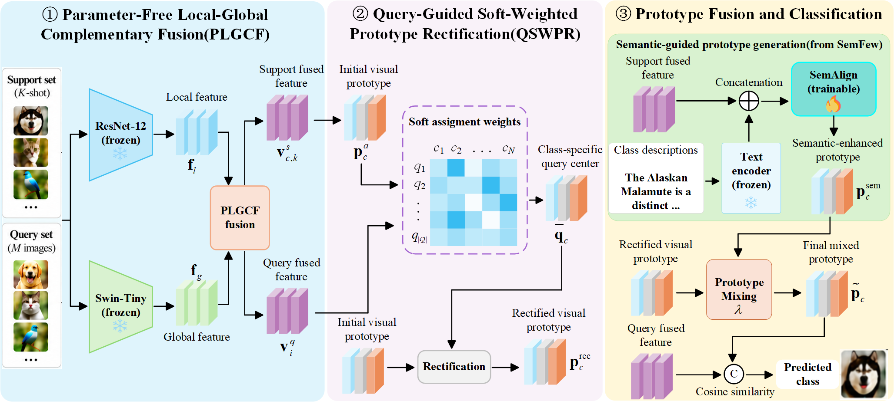

# LGRP-Net: Few-shot classification with local-global representation-guided prototype rectification

## Framework

The overall architecture of LGRP-Net is shown below.

<p align="center">
  
</p>

## Pretrained Weights and Semantic Features

The pretrained model weights and semantic feature files required by LGRP-Net are obtained from the official SemFew repository:

- **SemFew:** https://github.com/zhangdoudou123/SemFew

Please refer to the SemFew repository for the corresponding resources and follow its instructions and license terms. These third-party files are not included in this repository.

## Running Experiments

Run the following commands from the project root directory to run the TieredImageNet experiments with the `swin_res12` backbone under both 1-shot and 5-shot settings.

```bash
python compute_center.py --backbone swin_res12 --center mean --dataset TieredImageNet && \
python method/train.py --dataset TieredImageNet --backbone swin_res12 --mode clip --text_type gpt --shot 1 && \
python method/test.py --dataset TieredImageNet --backbone swin_res12 --mode clip --text_type gpt --shot 1 && \
python method/train.py --dataset TieredImageNet --backbone swin_res12 --mode clip --text_type gpt --shot 5 && \
python method/test.py --dataset TieredImageNet --backbone swin_res12 --mode clip --text_type gpt --shot 5
```

The commands perform the following steps:

1. Compute class centers using the mean strategy.
2. Train and evaluate the model under the 1-shot setting.
3. Train and evaluate the model under the 5-shot setting.

Before running the experiments, prepare the TieredImageNet dataset and obtain the required pretrained weights and semantic feature files from SemFew. Make sure all dataset and resource paths are configured correctly in the code.
